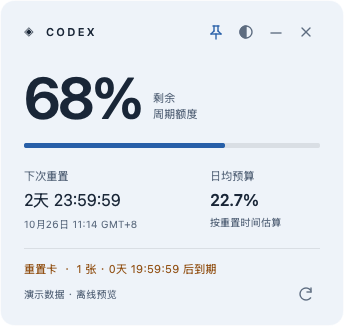
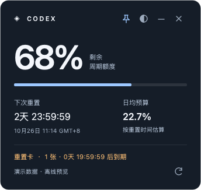
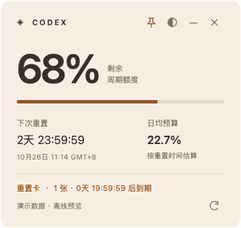

# Codex Quota Widget

**English** | [简体中文](README.zh-CN.md)

A lightweight desktop widget for Codex quota, reset times, and expiring reset credits. Includes native macOS and Windows interfaces.

The macOS interface uses Swift / Cocoa; Windows uses Qt with native Acrylic glass. Quota requests use the Python standard library, with no CodexBar dependency.

> An independent community project, not affiliated with OpenAI. Quota endpoints and update feeds are internal client contracts and may change upstream.

## Windows quick start

You need Python **3.12+** with `pythonw.exe` (included in the standard python.org Windows installer) and a signed-in Codex account. Install the Qt dependency before the first launch. No Swift toolchain or compilation is required.

Open PowerShell in the project directory and run:

```powershell
python -m pip install -r requirements-windows.txt
.\start-windows.ps1
```

Run `python windows_widget.py` instead to see startup errors in the terminal.

The window opens pinned, with rounded corners, a native Acrylic background, and no system title bar. Drag the empty area at the top to move it. The upper-right buttons control pinning, theme, minimization, and exit. Press F5 to refresh or Ctrl+Q to quit. Theme and position are saved on exit. A second launch avoids creating another instance. Startup at login is not configured automatically. The original Tk interface remains available with `python windows_widget.py --classic`.

The Windows launcher reads `CODEX_HOME/auth.json` when `CODEX_HOME` is set, otherwise `%USERPROFILE%/.codex/auth.json`. It only reads login data. To use another directory, run `python windows_widget.py --home "login-directory"`. A hidden subprocess refreshes quota every minute and is terminated after a 35-second timeout. Failed reads may fall back only to a cache verified for the current account.

Windows preferences (`windows.local.json`) and quota snapshots (`usage.local.json`) are stored in `%LOCALAPPDATA%/CodexQuotaWidget/`, independent of the source directory. Old source-directory caches are not imported automatically. Windows permissions inherit the user directory ACL. Both are ignored by Git. Windows currently has no system tray menu or Codex update indicator. The Swift build, menu bar, and update detection instructions below apply to macOS. See [Windows notes](docs/WINDOWS.md) (in Chinese) for details.

Demo mode uses synthetic data without reading login files or quota caches, or making network requests:

```powershell
.\start-windows.ps1 -Demo
```

### Windows screenshots

Generated from synthetic demo data; no live account or cache is used. These previews do not demonstrate native Acrylic rendering.

| Fog | Graphite | Apricot |
| --- | --- | --- |
|  |  |  |

## Features

- Shows the longest Codex quota window, usually weekly, with the remaining percentage, reset countdown, and reset time in GMT+8.
- Calculates a daily quota budget from the remaining percentage and time until reset. This is not a consumption-rate or runtime prediction.
- Shows available reset credits and the earliest expiration. macOS uses orange below 24 hours and red below 3 hours; both Windows interfaces use the same thresholds.
- Reads on startup, refreshes quota every minute, and updates the local countdown automatically. Manual refresh is supported.
- On macOS, checks for stable Codex updates hourly and displays a dot when one is available. It does not download or install updates.
- Supports dragging, pinning, and three themes: graphite, fog, and apricot. macOS restores hidden windows from the menu bar; Windows restores minimized windows from the taskbar.
- Preserves historical data after a failed read only when the cache can be verified for the same account. Marks stale data and never assumes a reset restored quota.

## macOS prerequisites

1. A Mac with Xcode Command Line Tools, which provide `swiftc`. If needed, run `xcode-select --install` and follow the system prompts.
2. Python **3.12+** with working trusted HTTPS CA certificates. See the compatibility notes below.
3. The Codex desktop app installed and signed in, with readable login data at `~/.codex/auth.json`.

The macOS launcher does not support API-key-only authentication, credentials stored only in Keychain, a custom `CODEX_HOME`, or third-party account managers. Installation detection scans `/Applications/Codex.app` and `/Applications/ChatGPT.app` for stable Codex installations. Linux desktop support has not been added.

The original macOS build was locally verified on macOS 26.7.1 / Intel x86_64 / Python 3.12.14. Python 3.13.2 passed offline Python tests only. Apple Silicon, other macOS versions, and all account plans have not been individually verified. There is no guaranteed minimum macOS version or compatibility promise for future Python releases.

## Build and launch on macOS

Download and extract the source, open a terminal in `codex-quota-widget`, then run:

```sh
python3 --version
swiftc --version
python3 build.py
open .build/Codex额度悬浮窗.app
```

The build script uses the Python interpreter running it. If `python3` is too old, use an installed `python3.12` or newer for all Python commands. Building does not query your account or download dependencies. Data reads begin after the app is launched.

The app bundle is created at `.build/Codex额度悬浮窗.app`. You can also press Command+Shift+G in Finder, enter the source directory's `.build` path, and open the app.

**Keep the Python environment in place.** The macOS app resolves its cache at runtime in `~/Library/Application Support/CodexQuotaWidget/`, so the built `.app` can be moved. Rebuild if the bound Python environment is moved or deleted, including a virtual environment inside the source directory. The generated `.app` is not a portable installer and has not been developer-signed or notarized. Follow normal macOS security prompts on first launch; do not disable system security globally.

Use the window buttons or the quota gauge icon in the menu bar to restore the window, refresh data, or switch themes. Hiding the window does not stop background refreshes. Quitting stops timers and reaps reader subprocesses. The project does not automatically install a login item.

## Current limitations

- Only the longest quota window is shown. A healthy weekly balance does not mean a shorter window is available. Local token usage, API balances, and billing are not tracked.
- Alerts are color changes inside the window, without system notifications, sound, or push messages.
- Dates use GMT+8 and the application UI is in Chinese. Language and time zone settings are not available.
- Theme and position are saved. Hidden and pinned states are not restored across launches; the app opens visible and pinned.
- No account management, automatic credit redemption, or automatic Codex updates. Windows has a single-instance guard; macOS has no instance coordination.
- Changes to endpoints, credential storage, installation paths, or update feed formats may break features. Long-running use, sleep recovery, and all platform combinations have not been fully verified.

See [support and known limitations](docs/SUPPORT.md) (in Chinese) for detailed behavior, error handling, and environment coverage.

## Updating and uninstalling

Quit the running app before updating the source. On macOS, rebuild in the same directory and launch the new app; updating source files does not replace the Python files inside an existing app bundle. On Windows, install any changed requirements and restart the launcher. Avoid running multiple copies.

To uninstall, quit first, then remove the widget's app bundle and source directory as needed. Remove macOS caches from `~/Library/Application Support/CodexQuotaWidget/` or Windows state from `%LOCALAPPDATA%/CodexQuotaWidget/` separately. macOS theme and position preferences are stored in the user's application preferences; Windows uses `windows.local.json`. Do not delete the Codex `~/.codex` login directory. If you manually configured startup at login, remove that entry as well.

## Data and privacy

See [PRIVACY.md](PRIVACY.md) (in Chinese) for the full policy. Key behaviors:

- Reads local Codex login data to fetch quota and reset credits. Does not redeem credits, refresh or modify login files, or read browser cookies.
- Sends the access token and account scope only to two fixed HTTPS GET endpoints on `chatgpt.com`. Redirects are rejected.
- On macOS, update checks use official feeds and may send an existing installation identifier, system/app versions, architecture, and plan type. They do not include login tokens or cookies.
- Caches contain only necessary quota, time, status, and account-hash fields. Account hashes are still account-related information and should not be published.
- Sends no telemetry or usage data to the project author.

macOS uses Application Support (new directory 0700; cache files 0600); Windows uses Local AppData with inherited Windows ACLs. Old source caches are preserved but not imported; the first run needs a successful refresh. CLI paths remain explicit. Old `*.local.json` files and `.build/` are ignored by Git. Do not upload your entire working directory or screenshots of real account data.

## Development and validation

Windows:

```powershell
python -m pip install -r requirements-windows.txt
python -m unittest discover -s tests -v
python scripts/package_source.py --check
```

macOS:

```sh
python3 -m unittest discover -s tests -v
python3 build.py
.build/Codex额度悬浮窗.app/Contents/MacOS/CodexQuotaWidget --check-guidance
.build/Codex额度悬浮窗.app/Contents/MacOS/CodexQuotaWidget --check-cache
.build/Codex额度悬浮窗.app/Contents/MacOS/CodexQuotaWidget --check-reader "$(command -v python3)"
```

Python tests use mocked responses and temporary files. Swift check modes perform calculations, temporary-directory checks, or launch disposable subprocesses without accessing real accounts or endpoints. GitHub Actions runs Windows checks and macOS compilation with offline regression tests. Qt-specific tests are skipped when the optional Windows UI dependency is not installed.

See [development notes](docs/DEVELOPMENT.md) (in Chinese) for project structure, build options, CLI behavior, and manual checks.

To generate a macOS documentation preview without reading accounts, caches, or the network:

```sh
.build/Codex额度悬浮窗.app/Contents/MacOS/CodexQuotaWidget \
  --preview .build/demo.png --demo --theme graphite
```

The theme can also be `fog` or `apricot`. Both `--preview` and `--demo` are required for synthetic data. Previews without `--demo` read the local cache and must not be used for public screenshots.

## FAQ

**The build reports no trusted CA certificates.** Check the Python certificate configuration. With the python.org macOS installer, look for `Install Certificates.command` in its application directory. Fix certificates and rebuild with the same interpreter; do not disable HTTPS verification.

**The widget reports expired login or unavailable data.** Confirm Codex itself works, then refresh. Credential storage or endpoint formats may have changed. When reporting an issue, share only sanitized errors and your OS/Python versions, never login files.

**Does “unknown” mean there are no reset credits?** No. Missing fields, unrecognized statuses, or network failures are shown as unknown. “No available credits” is shown only after a successful read confirms none remain unexpired and available.

**Are beta updates, automatic upgrades, or account switching supported?** macOS only reports stable updates and does not install them; Windows currently has no update indicator. After switching accounts in Codex, wait for the next refresh or refresh manually. The widget does not manage multiple account profiles.

## Source distribution

See the [GitHub upload guide](docs/GITHUB_UPLOAD.md) (in Chinese) and [public file list](PUBLIC_FILES.txt). To create an archive containing only public source files:

```sh
python3 scripts/package_source.py
```

On Windows, use `python` instead of `python3`. Extract `.build/codex-quota-widget-source.zip` before uploading its contents as repository source. Do not upload the ZIP as a substitute for source files or publish the entire local working directory. The script validates the file list and paths; it is not a credential scanner.

## Contributing and license

Issues and improvements are welcome. See [CONTRIBUTING.md](CONTRIBUTING.md); report security issues as described in [SECURITY.md](SECURITY.md). Both documents are in Chinese.

Source is public; there is no formal GitHub Release. See [CHANGELOG.md](CHANGELOG.md) for changes and the [release checklist](docs/RELEASING.md) before publishing.

Licensed under the [MIT License](LICENSE), allowing use, modification, distribution, and commercial use with the copyright and license notice preserved. The license covers this project's code only; it grants no third-party trademark rights or service access.

Windows Qt dependencies retain their own licenses; see [third-party notices](THIRD_PARTY_NOTICES.md). macOS and Windows `--classic` do not require Qt.
